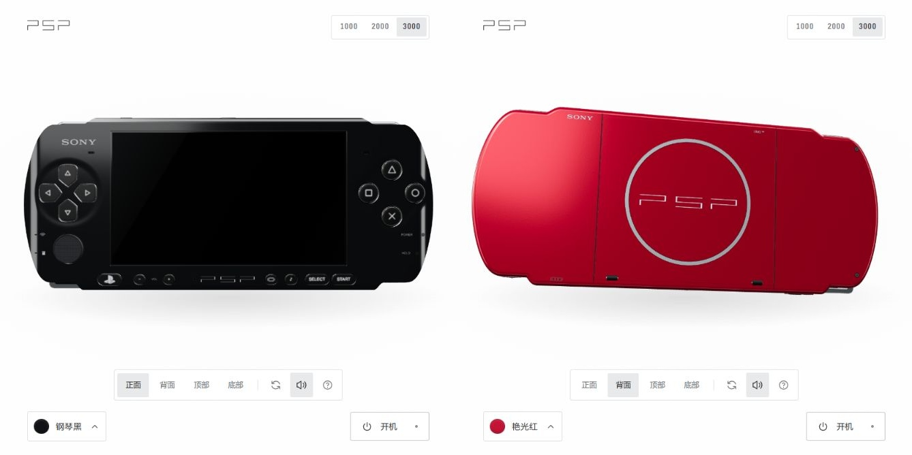
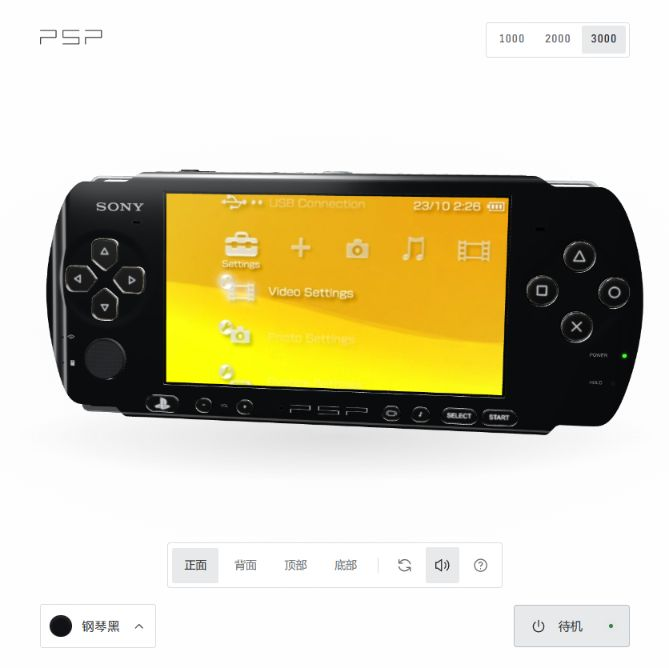
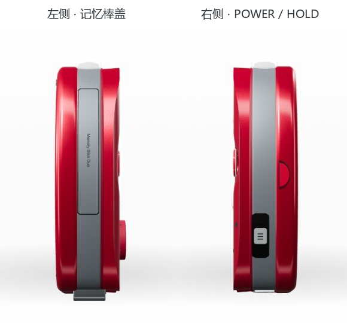

# virtual-PSP

**简体中文** | [English](README.en.md)

可以旋转、换色和操作的网页虚拟 PSP。使用 Three.js 展示 PSP-1000 / 2000 / 3000，通过本地桥接连接 PPSSPP，运行 Sony 6.61 原版 XMB。



## 实际运行截图

原版 XMB 的画面来自本机 PPSSPP，经 WebRTC 回传到模型屏幕。



左右侧的中框、记忆棒盖、POWER / HOLD 拨钮与电池盖卡扣：



## 已实现

- PSP-1000 / 2000 / 3000 外观切换，以及各机型的多种配色与漆面。
- 机身旋转和缩放、按键行程与回弹、摇杆拖动和回中、UMD 仓机械开合。
- 正面按键、L/R 肩键、电源/HOLD 等交互，鼠标与键盘组合输入。
- 原版 XMB 视频回传；当前 XMB 中 × 确认、○ 返回、△ 打开选项，□ 按当前界面定义执行。
- XMB 方向键点按单步，持续按住约 400 ms 后连移；暂停、断线和游戏切换取消残留连发。
- 本机 PPSSPP 声音，以及网页音量和静音控制。
- 几何构建缓存、材质纹理复用、独立会话生命周期与有界输入/视频缓冲。

这是网页外观与本机核心结合的实现，需要本地服务和 PPSSPP 原生窗口，声音直接由原生进程输出。完整硬件启动、从 XMB 启动游戏的完整流程、UMD 介质联动、WLAN 和麦克风尚未完成；游戏兼容性尚未在本项目验收。

## 快速开始

### 查看三维外观

需要 Node.js 20.11+。

```powershell
git clone git@github.com:koyama-kagami/virtual-PSP.git
cd virtual-PSP
Push-Location work/psp-studio
npm ci
npm run build
node serve.mjs
```

打开 **http://127.0.0.1:4330/**。此时可以查看和操作模型；运行原版 XMB 还需要准备本地核心。

### 运行原版 XMB

需要 Windows 和 uv，建议 PowerShell 7。仓库不包含固件、模拟器二进制、游戏、NAND 和用户存档。

在项目根目录下载并校验固定版本的 PPSSPP 与官方 Sony 更新文件：

```powershell
./work/psp-runtime/download-runtime.ps1
./work/psp-runtime/start-native.ps1 -Mode InstallFirmware
```

在 PPSSPP 选择 **File → Load...**，打开 `work/psp-runtime/downloads/PSP-6.61-EBOOT.PBP` 并选择 **Install**。完成后正常关闭安装窗口。

首次使用时，在管理员 PowerShell 安装项目专用的 debugger 入站限制：

```powershell
./work/psp-runtime/restrict-debugger.ps1
```

随后在普通 PowerShell 启动服务：

```powershell
./work/psp-runtime/start-runtime.ps1
```

打开 **http://127.0.0.1:4330/** 并点击电源。脚本用 uv 创建 Python 环境，启动或复用网页和桥接服务；点击电源时才启动/连接本项目 PPSSPP。运行期间保持原生窗口非最小化。

完整安装、启动和停止步骤见[运行说明](docs/psp-runtime-quickstart.md)。

## 操作

| 操作 | 方法 |
| --- | --- |
| 旋转 / 缩放 | 拖动机身 / 滚轮 |
| 按键 | 点击模型对应按键，按住保持 |
| 摇杆 | 拖动摇杆；Shift + 方向键 |
| 方向键 | 方向键或 WASD |
| × / ○ / △ / □ | X / O / I / J |
| L / R | Q / E |
| START / SELECT | Enter / Backspace |
| 电源 | P 短按连接、暂停或恢复；长按断开并暂停核心 |
| UMD | 点击背面仓盖，或按 U |

完整快捷键见页面问号。外观型号不会自动修改模拟器硬件配置；电源属于宿主会话控制，UMD 和 WLAN 当前属于机械交互。

## 技术方案

```text
Three.js 模型 → 输入与会话 → WebRTC DataChannel → Python Bridge → PPSSPP
     ↑                                                          │
 LCD VideoTexture ← WebRTC 视频 ← 窗口采集 / 最新帧槽 ←─────────────┘
```

Node.js 在 `127.0.0.1:4330` 提供页面与限定 HTTP 代理，Python 在 `127.0.0.1:4331` 管理会话、采集和媒体传输，再通过 debugger `4332` 控制原生核心。网页与桥接校验来源和会话凭据；原生 debugger 的网络入站由项目专用防火墙规则限制。

详见[架构说明](docs/architecture.md)。

## 开发与验证

```powershell
# 前端
Push-Location work/psp-studio
npm ci
npm test
npm run build
Pop-Location

# Windows 本地桥接
uv venv --python 3.12 work/psp-runtime/.venv
uv pip install --python work/psp-runtime/.venv/Scripts/python.exe -r work/psp-runtime/requirements.txt
Push-Location work/psp-runtime
uv run --python .venv/Scripts/python.exe python -m unittest discover -p 'test_*.py'
Pop-Location
```

首轮构建会烘焙三代面板，后续复用 `.cache/faceplates/`。构建产物写入 `outputs/psp-3000.html`，修改前端后重新构建并刷新即可。

```text
work/psp-studio/   三维外观、输入、会话与前端测试
work/psp-runtime/  本机桥接、启动脚本、核心版本清单与测试
docs/             运行说明、架构和实际页面截图
```

## 第三方组件

独立技术实验，与 Sony / PlayStation 无隶属关系。PSP、PlayStation、Sony 标识与原版系统画面属于各自权利人。软件与资源说明见 [THIRD_PARTY.md](THIRD_PARTY.md)。
